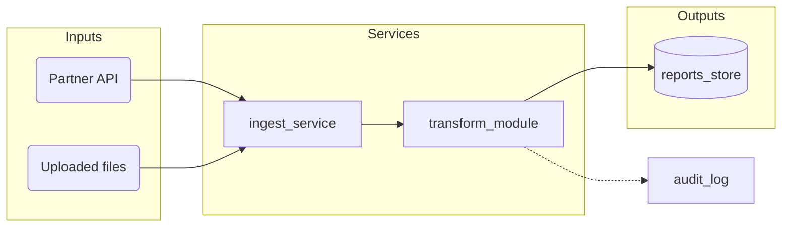

# Lineage and structure diagrams (Mermaid)

A lineage diagram shows what feeds into what. It works for any type of code.

## Step 1: Identify the nodes and edges from the code
- Nodes are the real components found in the code. Examples: tables, jobs, files,
  modules, classes, services, APIs, queues, config files, external systems.
- Edges are the real relationships found in the code. Examples: reads from,
  writes to, imports, calls, triggers, depends on, deploys.
- Look for evidence: imports, function calls, SQL FROM/JOIN, config references,
  pipeline definitions, infrastructure files, environment variables.
- Use only names that appear in the code. Never invent a node or an edge.
- If a relationship is likely but not provable from the code (dynamic calls,
  runtime configuration), draw it dashed (`-.->`) and add a note:
  "TBD: confirm with owner".

## Step 2: Choose the diagram type
- Flow or dependencies from inputs to outputs: `flowchart LR`
- Calls between components over time: `sequenceDiagram`
- Entities and their relationships: `erDiagram`
- Inheritance or composition of classes: `classDiagram`
- States and transitions: `stateDiagram-v2`

## Step 3: Group and lay out
- Group nodes into `subgraph` blocks by the structure the code already uses
  (layers, packages, folders, services, environments). Do not impose a layer
  model the code does not have.
- Order groups so flow reads left to right: inputs first, outputs last.
- Rounded `(name)` for external systems or inputs, rectangles `[name]` for
  internal components, cylinders `[(name)]` for stores.
- Label an edge only when the relationship type matters.
- Keep each diagram to about 15 nodes. For larger systems, draw one overview
  with groups only, then one detailed diagram per group.

## Optional marking
If the document tracks sensitive data or ownership, mark those nodes with a class
(for example `:::sensitive`) and add a one-line legend. Skip this when the
context does not call for it.

## Output
- Fenced `mermaid` code block, with a one-line caption above it.
- List the source files the diagram was derived from below it.
- Check that the syntax is valid before finishing.

## Example (generic)

## Output
- Put the diagram in a fenced `mermaid` code block.
- Add a one-line caption above it saying what it shows.
- List the source files the diagram was derived from below it.
- If any class marking is used (for example sensitive or owner), add a one-line
  legend that explains only the marks that appear.
- Check that the syntax is valid before finishing.