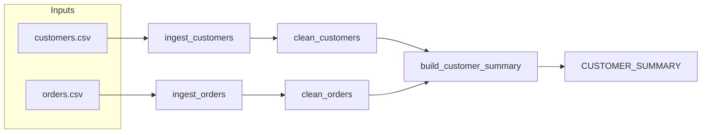

# CUSTOMER_SUMMARY

## Purpose

`CUSTOMER_SUMMARY` combines cleaned customer data with per-customer aggregates from cleaned orders. The transformation is implemented by `build_customer_summary` in [transform.py](../../transform.py), and its target name is configured in [config.py](../../config.py).

## Grain and keys

- Grain: One row per customer remaining after customer cleaning; order aggregates are grouped by `customer_id` and left-merged onto those customers. Source: [transform.py](../../transform.py).
- Primary key: `customer_id` is the grouping and join key. The repository does not declare a database primary-key constraint. Source: [transform.py](../../transform.py).

## Columns

The in-memory types are inferred by Pandas from the input data and transformations. Exact Snowflake column types are TBD: confirm with owner. The loader uppercases column names before writing. Source: [transform.py](../../transform.py) and [log.py](../../log.py).

| Column | Type | Description | Sensitivity (PII/none) | Source |
|---|---|---|---|---|
| `CUSTOMER_ID` | Pandas-inferred | Customer identifier used for grouping and joining. | TBD: confirm with owner | [transform.py](../../transform.py), [log.py](../../log.py) |
| `EMAIL` | Pandas-inferred | Customer email, trimmed and lowercased during cleaning. | PII | [transform.py](../../transform.py), [log.py](../../log.py) |
| `COUNTRY` | Pandas-inferred | Customer country, trimmed and uppercased during cleaning. | none | [transform.py](../../transform.py), [log.py](../../log.py) |
| `TOTAL_ORDERS` | Integer after conversion | Count of cleaned order rows per customer; missing counts are filled with zero. | none | [transform.py](../../transform.py), [log.py](../../log.py) |
| `TOTAL_SPENT` | Numeric after aggregation | Sum of cleaned order amounts per customer; missing sums are filled with zero and rounded to two decimal places. | none | [transform.py](../../transform.py), [log.py](../../log.py) |
| `FIRST_ORDER` | Pandas-inferred datetime | Earliest order date per customer. Invalid dates can become missing and are not filtered by `clean_orders`. | none | [transform.py](../../transform.py), [log.py](../../log.py) |
| `LAST_ORDER` | Pandas-inferred datetime | Latest order date per customer. Invalid dates can become missing and are not filtered by `clean_orders`. | none | [transform.py](../../transform.py), [log.py](../../log.py) |

## Lineage

Sources for this diagram: [ingest.py](../../ingest.py), [transform.py](../../transform.py), and [run_pipeline.py](../../run_pipeline.py).

## Load pattern and schedule

- Load pattern: The loader implementation defaults to full table overwrite; the current runner imports from missing `load.py` instead of the implementation in [log.py](../../log.py). Source: [run_pipeline.py](../../run_pipeline.py) and [log.py](../../log.py).
- Schedule: TBD: confirm with owner; no schedule is defined in the repository.
- Dependencies: Cleaned customer and order DataFrames are required to build the summary. Source: [transform.py](../../transform.py).

## Owner and retention

- Owner: TBD: confirm with owner.
- Retention: TBD: confirm with owner.
