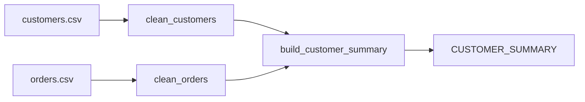

# CUSTOMER_SUMMARY

## Purpose

This table is the customer-level aggregate output of the pipeline. It combines the cleaned customer dimension with order-level metrics to produce a single row per customer that includes total order count, total spend, and first/last order dates. Source: [transform.py](../../transform.py), [run_pipeline.py](../../run_pipeline.py)

## Grain and keys
- Grain: one row per `customer_id`
- Primary key: `customer_id`

## Columns

| Column | Type | Description | Sensitivity (PII/none) | Source |
|---|---|---|---|---|
| `customer_id` | string/integer-like identifier | Customer identifier used to join customers to aggregated orders | none | [transform.py](../../transform.py) |
| `email` | string | Normalized customer email (trimmed, lowercased) from the source customer feed | PII | [transform.py](../../transform.py) |
| `country` | string | Normalized customer country code (trimmed, uppercased) | none | [transform.py](../../transform.py) |
| `total_orders` | integer | Count of valid orders associated with the customer, filled with 0 when no orders exist | none | [transform.py](../../transform.py) |
| `total_spent` | float | Sum of valid order amounts per customer, filled with 0.0 when no orders exist | none | [transform.py](../../transform.py) |
| `first_order` | datetime | Earliest valid order date for the customer | none | [transform.py](../../transform.py) |
| `last_order` | datetime | Latest valid order date for the customer | none | [transform.py](../../transform.py) |

## Lineage

## Load pattern and schedule
- Load pattern: full overwrite for each pipeline run; the `load_table` helper is configured with `overwrite=True` by default. Source: [log.py](../../log.py)
- Schedule: TBD: no schedule is defined in the repository. Source: [run_pipeline.py](../../run_pipeline.py)

## Owner and retention
- Owner: TBD: confirm with owner
- Retention: TBD: confirm with owner

No retention or ownership metadata is defined in code or configuration. Source: [config.py](../../config.py)
