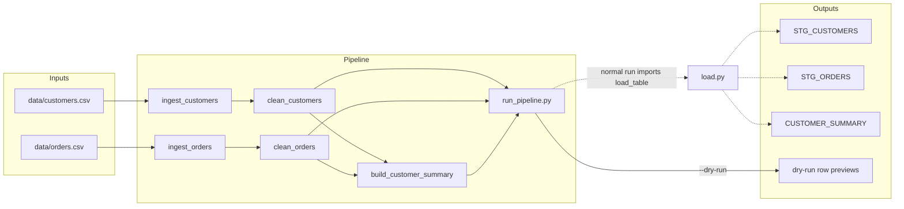

# copilot-agent-demo ETL

## Purpose

This Python script reads customer and order CSV files, cleans their records, and prepares a customer summary for Snowflake. The orchestration is in [run_pipeline.py](../../run_pipeline.py); the steps are implemented in [ingest.py](../../ingest.py), [transform.py](../../transform.py), and [log.py](../../log.py).

## Overview

| Item | Value |
|---|---|
| Type | Batch ETL |
| Orchestrator | Python script (`run_pipeline.py`) |
| Schedule | TBD: confirm with owner |
| Owner | TBD: confirm with owner |
| Environment(s) | Local script and configured Snowflake target; deployment environments TBD: confirm with owner |

## Sources and targets

| Direction | System | Object | Format |
|---|---|---|---|
| Source | Local filesystem | `data/customers.csv` | CSV |
| Source | Local filesystem | `data/orders.csv` | CSV |
| Target | Snowflake | `STG_CUSTOMERS` | Table |
| Target | Snowflake | `STG_ORDERS` | Table |
| Target | Snowflake | `CUSTOMER_SUMMARY` | Table |

The source directory and table names are configured in [config.py](../../config.py); the CSV files are read in [ingest.py](../../ingest.py). The expected CSV files are not present in the repository.

## Data flow

The diagram describes the flow declared in [run_pipeline.py](../../run_pipeline.py). It also marks the loader import issue: the runner imports `load_table` from `load.py`, which is absent, while a `load_table` implementation exists in [log.py](../../log.py).

Sources for this diagram: [run_pipeline.py](../../run_pipeline.py), [ingest.py](../../ingest.py), [transform.py](../../transform.py), [config.py](../../config.py), and [log.py](../../log.py).

## Steps

1. Ingestion: `ingest_customers` and `ingest_orders` read their named CSV files under `DATA_DIR` with `pandas.read_csv` and log row counts. Source: [ingest.py](../../ingest.py) and [config.py](../../config.py).
2. Customer cleaning: `clean_customers` trims and lowercases email, trims and uppercases country, parses `signup_date` with `errors="coerce"`, removes duplicate `customer_id` values, and drops rows with missing `customer_id` or `email`. Invalid signup dates become missing and are not separately dropped. Source: [transform.py](../../transform.py).
3. Order cleaning: `clean_orders` parses `order_date`, converts `amount` to numeric with `errors="coerce"`, drops rows missing `order_id`, `customer_id`, or `amount`, filters out amounts less than or equal to zero, and removes duplicate `order_id` values. Invalid order dates become missing and are not separately dropped. Source: [transform.py](../../transform.py).
4. Summary creation: `build_customer_summary` groups orders by `customer_id` and calculates order count, amount sum, earliest date, and latest date. It left-merges these values onto customers, fills missing order counts and sums with zero, rounds the sum to two decimal places, and returns the selected columns. Source: [transform.py](../../transform.py).
5. Output handling: `main` pairs the three DataFrames with their configured target tables. With `--dry-run`, it logs each row count and a three-row preview; otherwise it calls `load_table`. The runner currently cannot reach this code because its top-level import from the missing `load.py` fails. Source: [run_pipeline.py](../../run_pipeline.py).
6. Loader implementation: `log.py` contains a `load_table` function that uppercases column names and calls Snowflake `write_pandas` with automatic table creation and an overwrite default. This implementation is not imported by the current runner. Source: [log.py](../../log.py) and [run_pipeline.py](../../run_pipeline.py).

## Load pattern

- Mode: The `log.py` loader defaults to full table overwrite (`overwrite=True`); the current runner does not successfully wire to this loader. Source: [log.py](../../log.py) and [run_pipeline.py](../../run_pipeline.py).
- Watermark or key: No incremental watermark is defined. Customer and order de-duplication use `customer_id` and `order_id` respectively. Source: [transform.py](../../transform.py).
- Idempotent: The loader requests overwrite rather than append, but end-to-end execution is blocked by the missing `load.py` import. Source: [log.py](../../log.py) and [run_pipeline.py](../../run_pipeline.py).

## Dependencies

- Upstream: `data/customers.csv`, `data/orders.csv`, and Snowflake configuration values in [config.py](../../config.py). The CSV inputs are absent from the repository. Source: [config.py](../../config.py) and [ingest.py](../../ingest.py).
- Downstream: The configured target tables are `STG_CUSTOMERS`, `STG_ORDERS`, and `CUSTOMER_SUMMARY`. Consumers are TBD: confirm with owner. Source: [config.py](../../config.py).
- Runtime packages: A dependency manifest is not present; package names and versions are TBD: confirm with owner.

## Data quality checks

| Check | Where | Action on failure |
|---|---|---|
| Input CSVs are readable | [ingest.py](../../ingest.py) | `pandas.read_csv` exceptions are not caught in the ingestion functions and stop execution. |
| Customer IDs and email are present | [transform.py](../../transform.py) | Rows missing either value are dropped. |
| Order IDs, customer IDs, and numeric amounts are present | [transform.py](../../transform.py) | Rows missing these values after coercion are dropped. |
| Order amount is positive | [transform.py](../../transform.py) | Rows with `amount <= 0` are dropped. |
| Customer and order IDs are de-duplicated | [transform.py](../../transform.py) | `drop_duplicates` retains the first occurrence. |
| Snowflake write completes | [log.py](../../log.py) | Connection/write exceptions propagate; the connection is closed in `finally`. |

## Sensitive data

- PII columns: `email` is carried from customer input to the `CUSTOMER_SUMMARY` output. Source: [transform.py](../../transform.py).
- Masking / access controls: No masking or access-control behavior is defined in the repository; TBD: confirm with owner.
- Retention: TBD: confirm with owner.

## Configuration and secrets

- Config location: [config.py](../../config.py).
- Secrets: Snowflake account, user, and password are read from `SNOWFLAKE_ACCOUNT`, `SNOWFLAKE_USER`, and `SNOWFLAKE_PASSWORD`. Warehouse, database, schema, and role are read from `SNOWFLAKE_WAREHOUSE`, `SNOWFLAKE_DATABASE`, `SNOWFLAKE_SCHEMA`, and `SNOWFLAKE_ROLE`; defaults are provided for warehouse, database, and schema. Source: [config.py](../../config.py).

## Monitoring and alerts

- Alerts sent to: TBD: confirm with owner.
- Key metrics: Ingestion logs row counts; the loader logs loaded row counts and a success flag. The runner configures INFO-level logging. Source: [ingest.py](../../ingest.py), [log.py](../../log.py), and [run_pipeline.py](../../run_pipeline.py).

## Source files

- [run_pipeline.py](../../run_pipeline.py)
- [ingest.py](../../ingest.py)
- [transform.py](../../transform.py)
- [config.py](../../config.py)
- [log.py](../../log.py)
- [README.md](../../README.md)
